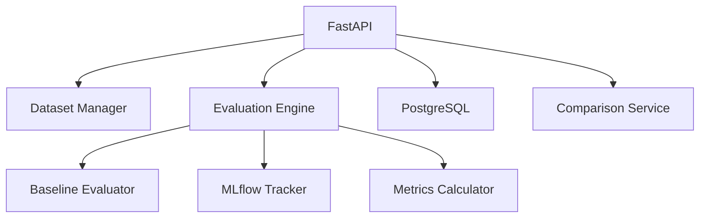

# LLMOps Lab

LLM evaluation and observability platform that compares LLM and RAG configurations using reproducible test datasets and transparent metrics.

## Features

- **Versioned Datasets**: Manage evaluation datasets with questions, expected answers, and contexts
- **Multiple Configurations**: Compare different models/pipelines
- **Comprehensive Metrics**: Latency, tokens, correctness, context relevance, faithfulness
- **Persistence**: PostgreSQL storage for runs and results
- **Comparison Reports**: Compare runs and configurations
- **MLflow Integration**: Experiment tracking (when available)
- **Offline Baseline**: Deterministic evaluation without paid APIs
- **Transparent Reporting**: Clear labeling of simulated vs real data

## Evaluation Methodology

- **Correctness**: Keyword overlap based scoring (deterministic baseline)
- **Latency**: Measured execution time
- **Tokens**: Estimated when not available from API
- **RAG Metrics**: Context relevance and faithfulness when RAG enabled
- **Limitations**: LLM-as-a-judge has biases - documented clearly

## Quick Start

### Installation

```bash
pip install -r requirements.txt
cp .env.example .env
```

### With Docker

```bash
docker-compose up --build
```

### Run API

```bash
python main.py
```

Docs at http://localhost:8002/docs

## Usage

```bash
# Create evaluation run
curl -X POST http://localhost:8002/runs \
  -H "Content-Type: application/json" \
  -d '{"dataset_version": "v1", "configs": [{"name": "baseline", "model_name": "llama2", "use_rag": false}]}'

# List runs
curl http://localhost:8002/runs

# Get run details
curl http://localhost:8002/runs/1

# Dashboard
curl http://localhost:8002/dashboard
```

## Architecture



## Testing

```bash
pytest tests/
```

## Limitations

- Deterministic baseline uses simple heuristics
- Real LLM evaluation requires API keys or Ollama
- RAGAS integration requires compatible inputs
- MLflow optional - gracefully degrades
- Costs only computed if pricing configured
- Results labeled as simulated/deterministic
# Updated
